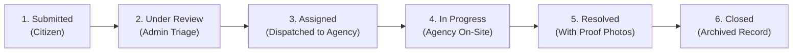
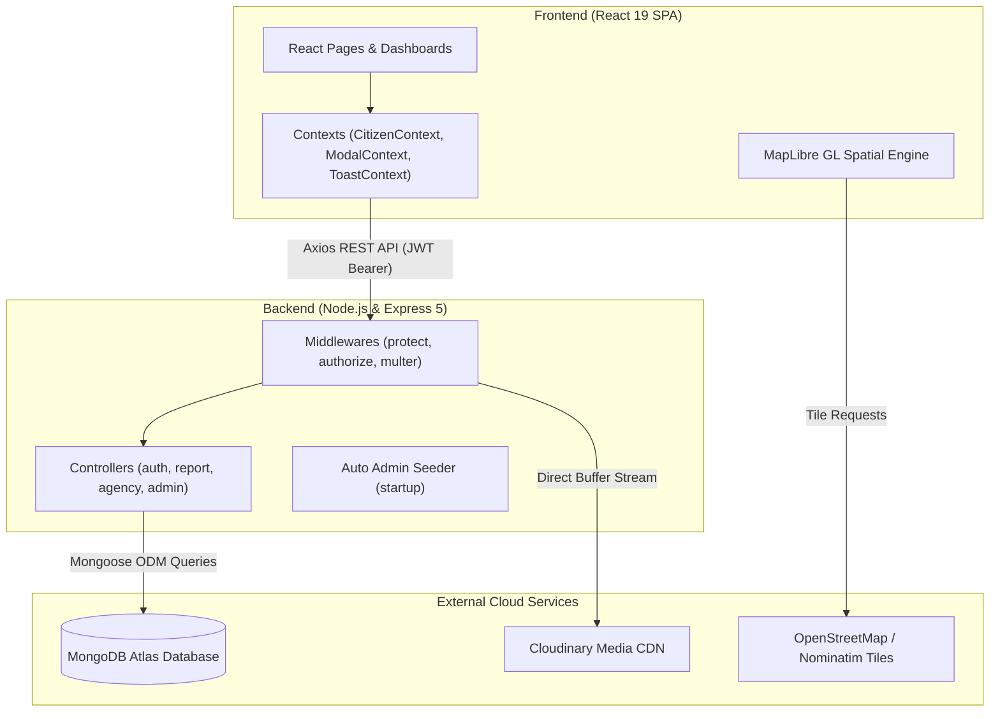

# GreenAlert 🌱

[](https://opensource.org/licenses/MIT)
[](https://nodejs.org/)
[](https://react.dev/)
[](https://expressjs.com/)
[](https://www.mongodb.com/)
[](https://tailwindcss.com/)
[](https://vitejs.dev/)

> **Civic Environmental Incident Reporting & Spatial Monitoring Platform**
> 
> GreenAlert connects citizens, municipal responder agencies, and government administrators on a single transparent platform to detect, report, and remediate environmental hazards before they escalate into community disasters.

---

## 📌 Table of Contents

- [Project Purpose & Overview](#-project-purpose--overview)
- [How It Works (The 6-Stage Incident Pipeline)](#-how-it-works-the-6-stage-incident-pipeline)
- [Core User Roles](#-core-user-roles)
- [Key Features](#-key-features)
- [System Architecture](#-system-architecture)
- [Project Directory Structure](#-project-directory-structure)
- [Prerequisites & Setup Instructions](#-prerequisites--setup-instructions)
  - [1. Clone the Repository](#1-clone-the-repository)
  - [2. Backend Setup](#2-backend-setup)
  - [3. Frontend Setup](#3-frontend-setup)
- [Environment Variables](#-environment-variables)
- [REST API Reference](#-rest-api-reference)
- [Default Seed Credentials](#-default-seed-credentials)
- [License](#-license)

---

## 🌍 Project Purpose & Overview

Environmental hazards—such as open chemical spills, blocked storm drainage channels, massive illegal refuse dumping, and oil leaks—frequently persist for weeks because citizens lack direct, transparent reporting channels to municipal responders.

**GreenAlert** bridges this communication gap:
1. **Citizens** identify hazards, attach GPS coordinates and photo evidence, and log incident reports in under two minutes.
2. **Administrators** verify incidents, triage priorities, and dispatch reports to accredited emergency or waste management agencies.
3. **Agencies** receive real-time ticket assignments, travel to the site, resolve the issue, and submit photographic proof of remediation.
4. **The Community** monitors incident progress across an interactive spatial map and public explore feed, ensuring full civic accountability.

---

## 🔄 How It Works (The 6-Stage Incident Pipeline)

Every incident follows a rigid, audited lifecycle from detection to permanent closure:



1. **`Submitted`**: A citizen logs an incident with description, category, priority, coordinates, and photo proof.
2. **`Under Review`**: Platform administrators review the submission to confirm validity and ensure emergency prioritization.
3. **`Assigned`**: The administrator delegates the incident to a verified agency specializing in that jurisdiction or domain.
4. **`In Progress`**: The agency acknowledges the assignment and dispatches field teams to the coordinates.
5. **`Resolved`**: The agency completes remediation and uploads compulsory **"After" proof images** along with resolution notes.
6. **`Closed`**: Both parties verify the outcome; the ticket is permanently closed and preserved on public records.

---

## 👥 Core User Roles

GreenAlert provides three dedicated, role-isolated portals:

| Role | Target Users | Key Capabilities |
| :--- | :--- | :--- |
| **Citizen** | General Public, Community Leads | • Multi-step incident reporting wizard with GPS auto-detection.<br/>• Interactive map view with search, filtering, and clustering.<br/>• Personal report tracking and bookmarked locations.<br/>• Public community feed to monitor local environmental health. |
| **Agency** | Waste Boards, EPA Regulators, Cleanup NGOs | • Dedicated dispatch dashboard with real-time assigned tickets.<br/>• Geolocation routing and severity inspection.<br/>• Workflow status transitions (`In Progress` ➔ `Resolved`).<br/>• Uploading verifiable before/after resolution evidence. |
| **Administrator** | Municipal Supervisors, Platform Auditing | • Comprehensive system analytics and incident metrics.<br/>• Incident triage and agency dispatch management.<br/>• Agency accreditation (license review and verification).<br/>• Citizen account management (audits, bans, unbans). |

---

## ✨ Key Features

- **📍 Spatial Mapping & Geocoding**: Interactive WebGL mapping powered by **MapLibre GL** with marker clustering, open-source tile sets, and reverse geocoding via OpenStreetMap/Nominatim. Zero proprietary map API costs.
- **📸 Ephemeral Cloud Media Pipeline**: Uses **Multer** in-memory storage to stream files directly into **Cloudinary CDN**, preventing server disk bloat while delivering responsive, optimized WebP imagery.
- **🛡️ Enterprise Security & Access Control**:
  - Stateless JSON Web Tokens (**JWT**) with HTTP-only cookie and Bearer authorization header support.
  - Cryptographic password hashing using **Bcrypt** with 12 salt rounds (`select: false` on Mongoose schemas).
  - Server-side **IDOR (Insecure Direct Object Reference)** mitigation ensuring agencies can only mutate tickets assigned to their organization.
- **💬 Accessible Modal Popup System**: Replaced native blocking browser alerts with an accessible, non-blocking React **ModalContext** featuring custom icons, Framer Motion spring physics, and keyboard shortcuts (`Enter` / `Escape`).
- **⚡ Modern Responsive UI**: High-fidelity dashboard layouts styled with **Tailwind CSS v4**, featuring mobile drawer navigation and smooth page transitions.

---

## 🏗️ System Architecture

GreenAlert is architected as a decoupled, full-stack **MERN** application:



---

## 📂 Project Directory Structure

```
GreenAlert/
├── client/                     # React 19 + Vite Frontend Application
│   ├── public/                 # Static assets & branding icons
│   ├── src/
│   │   ├── assets/             # Logos, hero images, and branding assets
│   │   ├── components/
│   │   │   ├── auth/           # Authentication screens & email step components
│   │   │   ├── landing/        # Marketing landing page sections
│   │   │   ├── map/            # MapLibre map component & spatial controls
│   │   │   └── ui/             # Status badges, skeletons, modals, error boundaries
│   │   ├── contexts/           # CitizenContext (auth), ModalContext, ToastContext
│   │   ├── layouts/            # DashboardLayout (Citizen), AgencyLayout, AdminLayout
│   │   ├── pages/
│   │   │   ├── admin/          # Admin dashboard, reports, users, organizations
│   │   │   ├── agency/         # Agency dashboard, tickets, settings
│   │   │   └── dashboard/      # Citizen dashboard, create report, explore, map
│   │   ├── App.jsx             # Top-level routing table and route guards
│   │   ├── index.css           # Tailwind CSS v4 styling rules
│   │   └── main.jsx            # React root mount and Axios global configuration
│   ├── vite.config.js          # Vite config & API proxy configuration
│   └── package.json
│
├── server/                     # Node.js + Express 5 Backend API
│   ├── src/
│   │   ├── config/             # MongoDB connection, Cloudinary init, admin seed
│   │   ├── controllers/        # Business logic for auth, reports, agency, admin
│   │   ├── middlewares/        # protect (JWT verification), authorize (RBAC)
│   │   ├── models/             # Mongoose schemas: User, Report, Organization
│   │   ├── routes/             # REST route endpoints
│   │   ├── app.js              # Express app, CORS, JSON parser & route mounting
│   │   └── server.js           # Server bootstrap and graceful shutdown
│   ├── package.json
│   └── .env.example            # Environment template
│
└── README.md                   # Complete Project Documentation
```

---

## 🚀 Prerequisites & Setup Instructions

### Prerequisites
- **Node.js**: v20.0.0 or higher
- **npm**: v10.0.0 or higher
- **MongoDB**: A free MongoDB Atlas cluster connection URI or local instance
- **Cloudinary**: A free Cloudinary account for media upload credentials

---

### 1. Clone the Repository

```bash
git clone https://github.com/Usmanabdulhameed020/Green-Alert.git
cd GreenAlert
```

---

### 2. Backend Setup

1. Navigate to the `server` folder:
   ```bash
   cd server
   ```

2. Install backend dependencies:
   ```bash
   npm install
   ```

3. Create your `.env` configuration file:
   ```bash
   cp .env.example .env
   ```
   *(Configure your `MONGODB_URI`, `JWT_SECRET`, and `CLOUDINARY_*` keys in `.env`)*

4. Start the backend API server:
   ```bash
   npm run dev
   ```
   The backend API will initialize on **`http://localhost:5001`**.  
   Verify health status at: `http://localhost:5001/api/v1/health`

---

### 3. Frontend Setup

1. Open a new terminal and navigate to the `client` folder:
   ```bash
   cd client
   ```

2. Install frontend dependencies:
   ```bash
   npm install
   ```

3. Create your client `.env` configuration:
   ```bash
   cp .env.example .env
   ```
   Ensure `VITE_API_URL` points to your backend instance:
   ```env
   VITE_API_URL=http://localhost:5001
   ```

4. Start the Vite development server:
   ```bash
   npm run dev
   ```
   Open your browser and navigate to **`http://localhost:5173`**.

---

## ⚙️ Environment Variables

### Backend (`server/.env`)

| Variable | Required | Description | Default / Example |
| :--- | :---: | :--- | :--- |
| `PORT` | Yes | Port on which the Express server listens | `5001` |
| `MONGODB_URI` | Yes | MongoDB Atlas or local connection string | `mongodb+srv://...` |
| `JWT_SECRET` | Yes | Secret key used to cryptographically sign JWTs | Secure random string |
| `JWT_EXPIRES_IN` | Yes | Lifetime of issued authentication tokens | `7d` |
| `CLOUDINARY_CLOUD_NAME`| Yes | Cloudinary cloud namespace | Cloudinary account name |
| `CLOUDINARY_API_KEY` | Yes | Cloudinary API access key | Cloudinary API key |
| `CLOUDINARY_API_SECRET`| Yes | Cloudinary API access secret | Cloudinary secret |
| `BCRYPT_SALT_ROUNDS` | No | Cost factor for password hashing | `12` |
| `ADMIN_EMAIL` | No | Auto-seeded Administrator email | `admin@greenalert.com` |
| `ADMIN_PASSWORD` | No | Auto-seeded Administrator password | `adminsecretpassword` |

### Frontend (`client/.env`)

| Variable | Required | Description | Default / Example |
| :--- | :---: | :--- | :--- |
| `VITE_API_URL` | Yes | Base URL of the backend REST API | `http://localhost:5001` |

---

## 📡 REST API Reference

All endpoints are versioned under `/api/v1`:

### Authentication (`/api/v1/auth`)
| Method | Endpoint | Access | Description |
| :--- | :--- | :--- | :--- |
| `POST` | `/auth/check-email` | Public | Checks if an email address exists before login step |
| `POST` | `/auth/register` | Public | Registers a new citizen user account |
| `POST` | `/auth/login` | Public | Authenticates user and returns JWT + user profile |
| `POST` | `/auth/register-org` | Public | Registers an agency organization with license upload |
| `GET` | `/auth/me` | Protected | Returns current authenticated user and settings |
| `PATCH` | `/auth/me` | Protected | Updates profile information |
| `DELETE`| `/auth/me` | Protected | Permanently deletes account and associated records |

### Incident Reports (`/api/v1/reports`)
| Method | Endpoint | Access | Description |
| :--- | :--- | :--- | :--- |
| `GET` | `/reports` | Public | Retrieves all reports for the Explore feed and Map |
| `POST` | `/reports` | Citizen | Creates a new environmental report with GPS coords |
| `GET` | `/reports/my-reports` | Citizen | Retrieves reports authored by logged-in citizen |
| `GET` | `/reports/:id` | Public | Retrieves single report with author & agency details |
| `DELETE`| `/reports/:id` | Citizen | Deletes an owned report (enforces author ownership) |

### Media Upload (`/api/v1/upload`)
| Method | Endpoint | Access | Description |
| :--- | :--- | :--- | :--- |
| `POST` | `/upload` | Protected | Uploads up to 5 photos/videos to Cloudinary CDN |

### Agency Operations (`/api/v1/agency`)
| Method | Endpoint | Access | Description |
| :--- | :--- | :--- | :--- |
| `GET` | `/agency/stats` | Agency | Returns agency dashboard metrics and resolution counts |
| `GET` | `/agency/profile` | Agency | Returns agency organization details |
| `PATCH` | `/agency/reports/:id/status`| Agency | Transitions ticket status (`In Progress` ➔ `Resolved`) with proof |

### Admin Operations (`/api/v1/admin`)
| Method | Endpoint | Access | Description |
| :--- | :--- | :--- | :--- |
| `GET` | `/admin/stats` | Admin | Aggregated platform-wide metrics & charts |
| `GET` | `/admin/reports` | Admin | Retrieves all reports for administrative review |
| `PATCH` | `/admin/reports/:id/assign`| Admin | Dispatches report to a verified agency organization |
| `GET` | `/admin/users` | Admin | Paginated list of registered users with search |
| `PATCH` | `/admin/users/:id/ban` | Admin | Suspends user account with mandatory reason |
| `PATCH` | `/admin/users/:id/unban` | Admin | Restores suspended user account |
| `PATCH` | `/admin/organizations/:id/verify`| Admin | Approves agency registration & grants portal access |

### Health Check (`/api/v1/health`)
| Method | Endpoint | Access | Description |
| :--- | :--- | :--- | :--- |
| `GET` | `/health` | Public | Returns database, Cloudinary, and uptime status |

---

## 🔑 Default Seed Credentials

On initial boot, GreenAlert automatically seeds a master administrator account:

- **Email**: `admin@greenalert.com`
- **Password**: `adminsecretpassword`
- **Role**: `admin`

*(You can customize these credentials in your `server/.env` using `ADMIN_EMAIL` and `ADMIN_PASSWORD`)*

---

## 📄 License

Distributed under the **MIT License**. See `LICENSE` for more information.

---

<p align="center">
  <b>GreenAlert</b> — Report Today. Protect Tomorrow. 🌍
</p>
